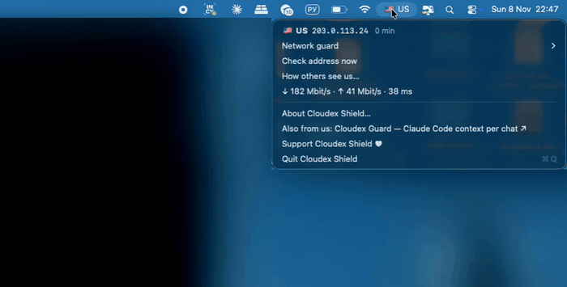

<p align="center"></p>

<p align="center"><b>When your VPN drops, the apps you choose pause — and resume where they stopped once it's back.</b><br>
A small, free macOS menu bar app: a kill switch for single apps. Not a VPN.</p>

<p align="center"><a href="https://github.com/trapastnik/cloudex-shield/releases/latest">Download</a> · <a href="#install">Install</a> · <a href="#your-data-stays-yours">Privacy</a> · <a href="#support">Support</a> · <a href="README.ru.md">Русский</a> · <a href="https://medfab-dev.tech/cloudex-shield/">Website</a></p>

<p align="center"><br><sub>Recorded in the app’s demo mode (<code>app/demo.sh</code>): no real network, documentation IP addresses.</sub></p>

> Cloudex Shield is an independent open-source project. It is not made, endorsed or supported by Anthropic or OpenAI. Claude and Claude Code are trademarks of Anthropic, ChatGPT is a trademark of OpenAI; they are named here only as examples of apps you can pause.

## The problem, and the fix

**The problem.** You work through a VPN — a corporate one, or one for privacy. It drops for a moment, reconnects, switches to another server or another country, or your Mac moves to a different Wi-Fi. The apps don't notice: they keep talking from whatever address you have now. That can be your real address without the VPN, or a country you didn't pick. And IPv6, DNS or split routing can reveal more than you think, even while the VPN looks connected.

**The fix: watch the address, pause on surprises.** Cloudex Shield checks which address and country your Mac goes out from. When it isn't one you allowed, it pauses the apps you chose within seconds. When the address is back, they resume exactly where they stopped — nothing is closed, nothing is lost.

Cloudex Shield is not a VPN. It never changes, blocks or routes your traffic; it only pauses apps on this Mac.

## What it does

- **Your country in the menu bar**, as claude.ai itself sees it: a flag and a code, like 🇺🇸 US. ⚠︎ US means the address is not in your allowed list; a red ❄︎ US means apps are paused right now. The menu shows the address, when it was checked, and a warning when your VPN routes some traffic another way, a second IP service sees a different address, apps that ignore the system proxy go out elsewhere, or IPv6 bypasses the VPN.
- **Pause, don't kill.** Pick the apps under **Network guard** — Claude, ChatGPT, Codex, Cursor, Perplexity and Telegram are offered when installed, and **Add app…** takes any other. On an unexpected address the apps — and everything they started; for Claude that includes Claude Code and its MCP servers — are paused with `SIGSTOP` and continue with `SIGCONT` once the address is allowed again. When the network changes or the Mac wakes, guarded apps are paused right away, before they can send anything, and resume as soon as the new address checks out.
- **Allowed countries.** Tick the countries your apps may run from. For apps with a known site (claude.ai, chatgpt.com, perplexity.ai) the country is the one that site sees; for the rest, the one the IP services see.
- **Short breaks when you need them.** **Resume and leave alone for 15 minutes** when something is paused, **Pause guard for 15 minutes** or **1 hour**, or switch pausing off entirely.
- **How others see us** — what claude.ai, the Claude API, chatgpt.com, Cloudflare and four IP services see; IPv6, DNS server and time zone checks, and what apps that ignore the system proxy see.
- **Speed test** — download, upload and latency to Claude, the Claude API and ChatGPT in one menu line. Runs only when you click it.
- **Safe by design.**
  - System apps, Cloudex Shield itself and VPN clients can never be paused — a paused VPN couldn't reconnect, and the apps would never resume.
  - Quitting Cloudex Shield always resumes everything.
  - The login item restarts it within a minute after a crash, and it resumes what it had paused.
  - Nothing is paused until you pick at least one country and one app.

The interface is English, or Russian on a Russian system.

## Install

You need macOS 13 or later.

### The usual way: download and drag

1. **Download** [`CloudexShield.dmg`](https://github.com/trapastnik/cloudex-shield/releases/latest/download/CloudexShield.dmg).
2. **Open it and drag** Cloudex Shield onto the Applications folder.
3. **Open Cloudex Shield.** The first time, macOS says it can't check the developer. That's expected for free apps distributed outside the App Store without a paid Apple developer certificate — it doesn't mean anything is wrong. To allow it once:
   - open **System Settings → Privacy & Security**,
   - scroll down to the message about Cloudex Shield and click **Open Anyway**,
   - confirm. macOS remembers the choice; you won't be asked again.
4. **Choose Start at login** when it asks. Recommended: it only protects while it runs, and the login item also restarts it within a minute if it ever crashes — so paused apps are always released.
5. **Pick apps and countries.** In the menu, open **Network guard**, tick the apps to pause and the countries you allow.

Changed your mind? Quit it from the menu and run the uninstall command below — it removes the app and its login item.

### One command in Terminal

No dialogs, nothing to approve in System Settings:

```bash
curl -fsSL https://raw.githubusercontent.com/trapastnik/cloudex-shield/main/install.sh | sh
```

It downloads the latest release, checks its SHA-256, installs the app into `~/Applications`, starts it and turns on start at login. [Read the script](install.sh) first if you like. To remove everything:

```bash
curl -fsSL https://raw.githubusercontent.com/trapastnik/cloudex-shield/main/install.sh | sh -s uninstall
```

Your settings stay in `~/Library/Preferences/io.github.trapastnik.cloudex-shield.plist`; delete that file too if you want them gone.

### From source

```bash
git clone https://github.com/trapastnik/cloudex-shield.git && cd cloudex-shield
zsh app/build.sh        # needs Xcode Command Line Tools: xcode-select --install
```

It builds the app into `~/Applications` and starts it.

## Your data stays yours

**What Cloudex Shield never touches:** your API keys and tokens, your accounts and logins, your passwords and Keychain, what your apps show or send, your files and projects. It doesn't read, change or route network traffic.

**What it asks macOS for:** nothing. No Accessibility, Full Disk Access, Screen Recording, Keychain or Location permission — you will never see such a prompt from it.

**What it does see:** the list of running processes on your Mac, to find the apps you picked and everything they started; your public addresses and their countries; whether a system proxy is on. "How others see us" also shows your DNS server, your Mac's time zone, region and languages — on screen only. Settings stay in `~/Library/Preferences/io.github.trapastnik.cloudex-shield.plist`. The app makes only the requests listed [below](#what-goes-over-the-network). No analytics, no telemetry, no server of ours.

### Don't take our word for it

There is no paid audit of this project, but everything above can be checked independently:

1. **Read the code.** It is all here — about 1,350 lines of Swift.
2. **Check where the file came from — or skip it entirely.** Releases are built by GitHub Actions from this repository's code, and GitHub signs a provenance attestation for every file. One command proves your download was built from this source: `gh attestation verify CloudexShield.dmg --repo trapastnik/cloudex-shield`. You can also compare its SHA-256 with `SHA256SUMS.txt` (`shasum -a 256 CloudexShield.dmg`). If you'd rather not trust a binary at all, build the app from this source yourself — it takes a minute (see *From source*).
3. **Watch the network.** Run a firewall that shows every connection, such as the free open-source [LuLu](https://objective-see.org/products/lulu.html) by Objective-See or [Little Snitch](https://www.obdev.at/products/littlesnitch/). You'll see only the hosts listed below.
4. **Scan the file.** Upload the DMG to [VirusTotal](https://www.virustotal.com) to check it with about 70 antivirus engines, or compare its SHA-256 with `SHA256SUMS.txt` in the release.

## What goes over the network

- Every 20 seconds, and right after the network changes or the Mac wakes: `claude.ai/cdn-cgi/trace` (plus the site of each guarded app that has one), `api.ipify.org`, `ipv4.icanhazip.com`, `api6.ipify.org`. Every 3 seconds only while apps are paused or about to be, so they resume quickly.
- If a system proxy is on: one more request to `api.ipify.org` that bypasses the proxy on every check — it shows ipify your address without the VPN.
- Country of an address: `ipinfo.io`, fallback `api.country.is`; the address is part of the request, the answer is cached until restart.
- Speed test (on demand): `speed.cloudflare.com` (up to 25 MB down for at most 6 seconds, 1.5 MB up) and four requests each to `claude.ai`, `api.anthropic.com`, `chatgpt.com`.
- "How others see us" (on demand) adds `api.anthropic.com`, `chatgpt.com`, `1.1.1.1`, `checkip.amazonaws.com`, `v4.ident.me`, `ipv6.icanhazip.com`, `ipinfo.io/json`, your DNS server's address to `ipinfo.io`, and a DNS lookup of `whoami.akamai.net`. With a system proxy on, it deliberately reaches `claude.ai` and `api.ipify.org` around the proxy to show what proxy-unaware apps see — those two sites then see your address without the VPN.

## Troubleshooting

- **The icon is gone.** macOS hides menu bar icons that don't fit (behind the camera notch). Check it runs: `pgrep -lx CloudexShield`. If it does, ⌘-drag it to the right or free some space.
- **An app looks frozen.** That's a pause. Cloudex Shield resumes it when your address is allowed again, when you click **Resume and leave alone for 15 minutes**, when you quit Cloudex Shield, or right after it restarts. If it isn't running, open it again.
- **The menu bar shows ◌ net.** The address isn't known yet: there's no connection, or the IP services don't answer. It updates on the next check; **Check address now** in the menu runs one at once.

## Coming from Cloudex Guard 1.1

Until Cloudex Guard 1.2, this network guard was part of [Cloudex Guard](https://github.com/trapastnik/cloudex-guard). On its first launch, Cloudex Shield takes your allowed countries, guarded apps and the on/off switch from Cloudex Guard 1.1, and resumes any processes 1.1 left paused. Update Cloudex Guard to 1.2 as well: it no longer has the network guard, so only Cloudex Shield pauses apps.

## Sibling app: Cloudex Guard

[Cloudex Guard](https://github.com/trapastnik/cloudex-guard) is a separate free menu bar app from the same author, for Claude Code in the Claude desktop app: the context fill of every chat, chats waiting for you, plan limits, and a 🧹 handoff before you clear a chat. It makes no network requests at all. Website: https://medfab-dev.tech/cloudex-guard/

## Support

Cloudex Shield is free. If it saves you time, you can support its development:

- **Bitcoin (BTC):** `1JZ3neiNzLC5kiGAer5UQGQvK9xSJqnc87`
- **Ethereum (ETH):** `0x2f507c67655ddf3638c83238c71d51defe7b1fec`
- **USDT (Tether), ERC-20 on the Ethereum network only:** `0x2f507c67655ddf3638c83238c71d51defe7b1fec`

Please double-check the network: tokens sent through other networks (BNB Chain, Tron and so on) can be lost. Stars, bug reports and ideas in [Issues](https://github.com/trapastnik/cloudex-shield/issues) help too.

## Credits

The pausing and leak-check approach was inspired by [Kordon](https://github.com/ef1m03/kordon) by Efimov Dev: confirming the address with several services, asking the AI service itself, `SIGSTOP` on the whole process tree, DNS check via `whoami.akamai.net`. Cloudex Shield's code is written from scratch; nothing was copied from Kordon. If you need a full kill switch for Mac, Windows and Linux with a browser extension and Telegram alerts, have a look at Kordon.

## License

MIT — see [LICENSE](LICENSE).
